For financial data analysis, it is important to know certain terminologies, their purpose, and how to calculate them.

I’m taking [Matt Harrison](https://twitter.com/__mharrison__)’s Linkedin course on [Python for Finance](https://www.linkedin.com/learning/getting-started-with-python-for-finance). Here I note down all the Pandas techniques and concepts explored in the course. As always if you find an error, don’t hesitate to contact me.

# Loading data

We use the `yfinance` library to load our stock data. The stocks listed in NASDAQ stock exchange are identified using a unique symbol aka **ticker** . I was interested in seeing how Pfizer(PFE) stocks fair in the last 3 years.

``` python
import yfinance as yf
import pandas as pd
import numpy as np
import matplotlib.pyplot as plt 

pharma_df = yf.download('PFE JNJ', start='2015-01-01', end='2023-04-28')
pharma_df.head() #<1>
```

1.  Displays first 5 rows

    [                       0%                       ]
    [*********************100%***********************]  2 of 2 completed

|  | Adj Close |  | Close |  | High |  | Low |  | Open |  | Volume |  |
|----|----|----|----|----|----|----|----|----|----|----|----|----|
|  | JNJ | PFE | JNJ | PFE | JNJ | PFE | JNJ | PFE | JNJ | PFE | JNJ | PFE |
| Date |  |  |  |  |  |  |  |  |  |  |  |  |
| 2015-01-02 | 83.076210 | 21.793076 | 104.519997 | 29.724857 | 105.550003 | 30.151802 | 104.129997 | 29.620493 | 105.050003 | 29.667933 | 5753600 | 16371571 |
| 2015-01-05 | 82.495979 | 21.674822 | 103.790001 | 29.563566 | 104.730003 | 29.800758 | 103.680000 | 29.421251 | 104.480003 | 29.743834 | 8079300 | 24786391 |
| 2015-01-06 | 82.090607 | 21.855684 | 103.279999 | 29.810247 | 104.989998 | 30.227703 | 102.940002 | 29.525618 | 104.339996 | 29.667933 | 7428000 | 29468681 |
| 2015-01-07 | 83.902840 | 22.154783 | 105.559998 | 30.218216 | 105.830002 | 30.237192 | 103.809998 | 29.962049 | 103.910004 | 30.094877 | 7931700 | 20248816 |
| 2015-01-08 | 84.562553 | 22.606922 | 106.389999 | 30.834915 | 106.489998 | 30.967743 | 105.750000 | 30.569260 | 106.059998 | 30.683111 | 9916000 | 49169522 |

## Chaining

Matt introduces one of the features in Pandas called **chaining**. It allows reading the code as a recipe. One can simply go through from top to bottom and understand how the code works. We leverage `pipe()` pandas function. We can use it call any function.

From the two stocks, `PFE` and `JNJ`, we need only `PFE`. So, we can try to use chaining principle.

### Without chaining

``` python
def fix_cols(df):
    cols = df.columns
    outer = [col[0] for col in cols]
    df.columns = outer
    return df

pfe_df1 = pharma_df.iloc[:,1::2]
pfe_df1 = fix_cols(pfe_df1)
pfe_df1
```

|            | Adj Close | Close     | High      | Low       | Open      | Volume   |
|------------|-----------|-----------|-----------|-----------|-----------|----------|
| Date       |           |           |           |           |           |          |
| 2015-01-02 | 21.793076 | 29.724857 | 30.151802 | 29.620493 | 29.667933 | 16371571 |
| 2015-01-05 | 21.674822 | 29.563566 | 29.800758 | 29.421251 | 29.743834 | 24786391 |
| 2015-01-06 | 21.855684 | 29.810247 | 30.227703 | 29.525618 | 29.667933 | 29468681 |
| 2015-01-07 | 22.154783 | 30.218216 | 30.237192 | 29.962049 | 30.094877 | 20248816 |
| 2015-01-08 | 22.606922 | 30.834915 | 30.967743 | 30.569260 | 30.683111 | 49169522 |
| ...        | ...       | ...       | ...       | ...       | ...       | ...      |
| 2023-04-21 | 39.779552 | 40.209999 | 40.299999 | 39.910000 | 40.090000 | 19227100 |
| 2023-04-24 | 39.482765 | 39.910000 | 40.200001 | 39.709999 | 40.189999 | 17633700 |
| 2023-04-25 | 38.908978 | 39.330002 | 39.919998 | 39.279999 | 39.750000 | 24492400 |
| 2023-04-26 | 38.216469 | 38.630001 | 39.189999 | 38.400002 | 39.160000 | 22401400 |
| 2023-04-27 | 38.325291 | 38.740002 | 38.830002 | 38.310001 | 38.619999 | 22434000 |

2094 rows × 6 columns

### With chaining

``` python
pfe_df = (pharma_df
          .iloc[:,1::2] #<1>
          .pipe(fix_cols) #<2>
         )
pfe_df
```

1.  Retrieves only PFE stock data
2.  Removes the ticker and just shows

|            | Adj Close | Close     | High      | Low       | Open      | Volume   |
|------------|-----------|-----------|-----------|-----------|-----------|----------|
| Date       |           |           |           |           |           |          |
| 2015-01-02 | 21.793076 | 29.724857 | 30.151802 | 29.620493 | 29.667933 | 16371571 |
| 2015-01-05 | 21.674822 | 29.563566 | 29.800758 | 29.421251 | 29.743834 | 24786391 |
| 2015-01-06 | 21.855684 | 29.810247 | 30.227703 | 29.525618 | 29.667933 | 29468681 |
| 2015-01-07 | 22.154783 | 30.218216 | 30.237192 | 29.962049 | 30.094877 | 20248816 |
| 2015-01-08 | 22.606922 | 30.834915 | 30.967743 | 30.569260 | 30.683111 | 49169522 |
| ...        | ...       | ...       | ...       | ...       | ...       | ...      |
| 2023-04-21 | 39.779552 | 40.209999 | 40.299999 | 39.910000 | 40.090000 | 19227100 |
| 2023-04-24 | 39.482765 | 39.910000 | 40.200001 | 39.709999 | 40.189999 | 17633700 |
| 2023-04-25 | 38.908978 | 39.330002 | 39.919998 | 39.279999 | 39.750000 | 24492400 |
| 2023-04-26 | 38.216469 | 38.630001 | 39.189999 | 38.400002 | 39.160000 | 22401400 |
| 2023-04-27 | 38.325291 | 38.740002 | 38.830002 | 38.310001 | 38.619999 | 22434000 |

2094 rows × 6 columns

As you can see this makes an easier reading. We use the `pipe()` to call our `fix_cols` function. The resulting dataframe has only the outer level column names. Indeed, I agree that as more analysis are added, it gets complicated and harder to understand. Indeed, the intermediate calculation steps are not shown in the final version which makes it difficult to visualise the operation instantaneously.

# Plotting

Since Pandas’ plotting functionality is built on top of Matplotlib, we use it easily to plot our data.

``` python
(pharma_df
 .iloc[:,1::2] 
 .pipe(fix_cols) 
 .Close #<1>
 .plot() #<2>
)
```

1.  Fetches only the volume column. Dataframe is now a series.
2.  Date is used at x-axis and the volume column values at y-axis.

    <AxesSubplot:xlabel='Date'>

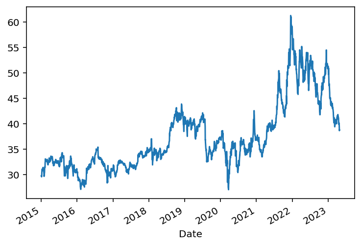

We can also adjust plot window size using Matplotlib’s `figsize` function.

``` python
pfe_vol = (pharma_df
 .iloc[:,1::2] 
 .pipe(fix_cols) 
 .Volume
 .plot(figsize=(10,2)) #<1>
)
```

1.  Adjusting the plot window size so we can visualise the volume easily

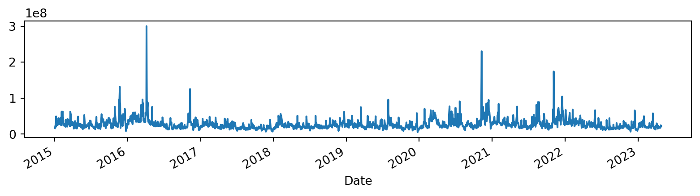

# Resampling

Since we have date as our row index, we can leverage `.resample()` feature of Pandas to convert our `PFE` raw data into time periods we want to visualise. The `.resample()` takes in an argument which is appropriate for the index. In our case it is date. So, it can take monthly(`M`), weekly(`W`), daily(`Y`), quarterly(`Q`) etc. Bi monthly is possible with `2M`.

``` python
(pfe_df
 .Close
 .resample('M') #<1> 
 .mean() #<2>
 .plot()
)
```

1.  Returns resampler object. Looks for an aggregate function.
2.  Monthly average

    <AxesSubplot:xlabel='Date'>

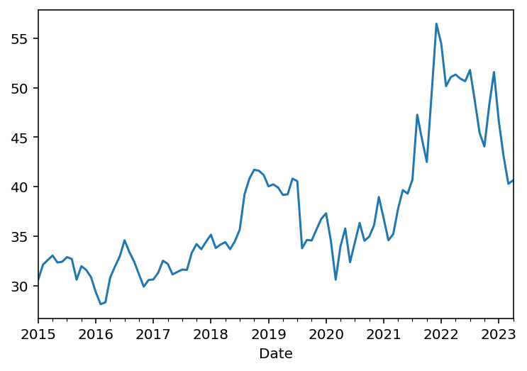

If we want to aggregate two columns, then we can use `.agg()` function.

``` python
(pfe_df
 .resample('M')
 .agg({'Close': 'max', 'Open': 'first'}) #<1>
 .loc['jan 2020': 'apr 2023'] #<2>
 .plot()
)
```

1.  `Close` column with grouped by max values and `Open` with `first` non-null value.

    <AxesSubplot:xlabel='Date'>

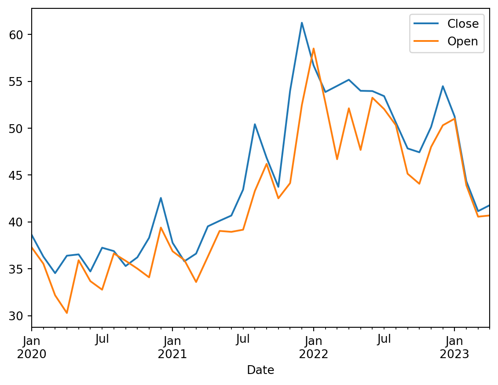

# Candle Stick chart

With stock data, it is easier to visualise its pattern using a candle stick chart. Candle stick plot is not in Pandas. We can write our own plot function using matplotlib.

``` python
from matplotlib import dates
fig, ax = plt.subplots(figsize=(10,5))
def plot_candle(df, ax):
    #wick
    ax.vlines(x=df.index, ymin=df.Low, ymax=df.High, colors='k', linewidth=1)
    #red - decrease
    red = df.query('Close < Open')
    ax.vlines(x=red.index, ymin=red.Close, ymax=red.Open, colors='r', linewidth=3)
    #green - increase
    green = df.query('Close >= Open')
    ax.vlines(x=green.index, ymin=green.Close, ymax=green.Open, colors='g',linewidth=3)
    ax.xaxis.set_major_locator(dates.MonthLocator())
    ax.xaxis.set_major_formatter(dates.DateFormatter('%b-%y'))
    ax.xaxis.set_minor_locator(dates.DayLocator())
    ax.grid(color='grey')
    return df


(pfe_df
 .resample('d')
 .agg({'Close': 'last', 'Open': 'first', 'Low':'min', 'High':'max'})
 .loc['jan 2023': 'apr 2023']
 .pipe(plot_candle,ax)
)
```

|            | Close     | Open      | Low       | High      |
|------------|-----------|-----------|-----------|-----------|
| Date       |           |           |           |           |
| 2023-01-01 | NaN       | NaN       | NaN       | NaN       |
| 2023-01-02 | NaN       | NaN       | NaN       | NaN       |
| 2023-01-03 | 51.259998 | 51.009998 | 50.820000 | 51.330002 |
| 2023-01-04 | 50.130001 | 50.290001 | 49.520000 | 50.630001 |
| 2023-01-05 | 49.660000 | 49.730000 | 48.919998 | 49.990002 |
| ...        | ...       | ...       | ...       | ...       |
| 2023-04-23 | NaN       | NaN       | NaN       | NaN       |
| 2023-04-24 | 39.910000 | 40.189999 | 39.709999 | 40.200001 |
| 2023-04-25 | 39.330002 | 39.750000 | 39.279999 | 39.919998 |
| 2023-04-26 | 38.630001 | 39.160000 | 38.400002 | 39.189999 |
| 2023-04-27 | 38.740002 | 38.619999 | 38.310001 | 38.830002 |

117 rows × 4 columns

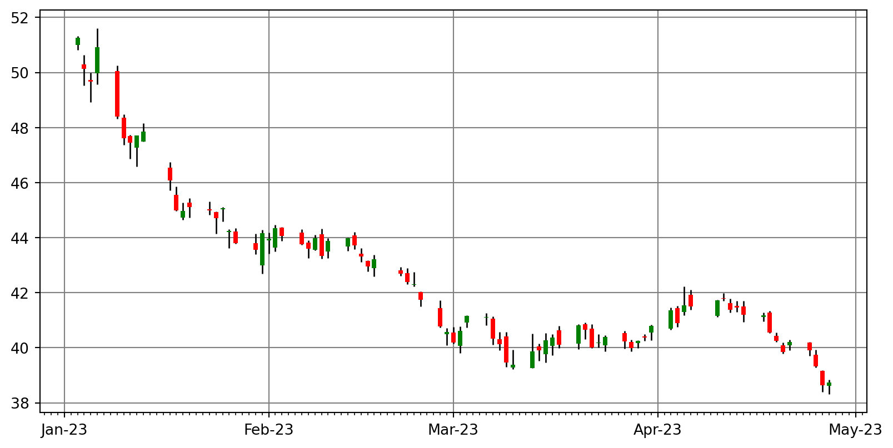

With the chart, we can determine the patterns such as bearish, bullish etc. We can change `.loc`for the period we want to see the pattern.

# Calculations

In this section we learn certain metrics used on financial data.

## Returns

How much percentage of return can be expected? With pandas, we can simply use `.pct_change()` function and get the values. Plotting them is as simple as shown previously.

``` python
(pfe_df
 .pct_change()
 .Close
 .plot()
)
```

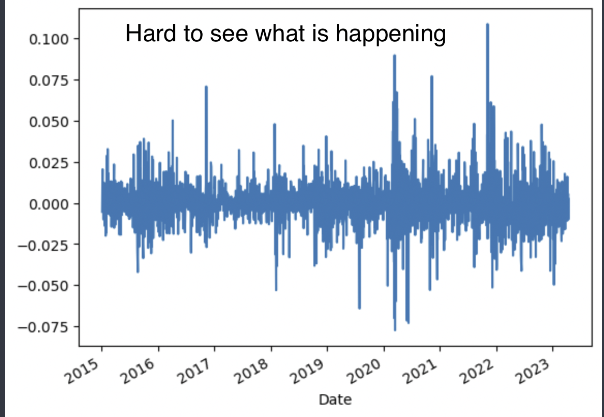

Histogram can be an option but it doesn’t show negative swing. Somewhat appropriate would be to use bar plot.

``` python
(pfe_df
 .pct_change()
 .Close
 .iloc[-100:] #last 100 rows
 .plot.bar()
)
```

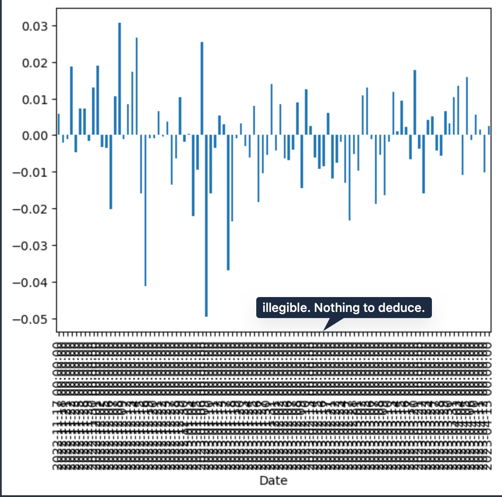

This plot shows the negative trends but the X-axis is illegible. We don’t know on which date the closing stock prices changed. This is because Pandas converts/groups whatever on the x-axis into categorical variables. For example, for categorical variable such as elephants, dogs and cats this works but for dates that isn’t correct.

What if we explicitly say the x-axis as `dates`.

``` python
fig, ax = plt.subplots(figsize=(10,4))
(pfe_df
 .pct_change()
 .Close
 .iloc[-100:]
 .plot.bar(ax=ax)
)
ax.xaxis.set_major_locator(dates.MonthLocator())
ax.xaxis.set_major_formatter(dates.DateFormatter('%b-%y'))
ax.xaxis.set_minor_locator(dates.DayLocator())
```

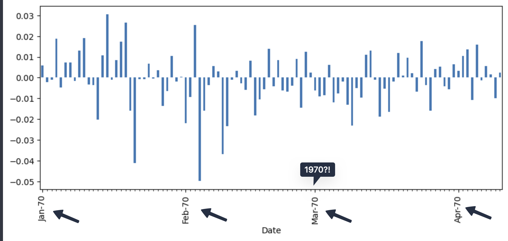

1970?!? Still Pandas converts dates to categorical variables.

The solution Matt suggests is to use matplotlib.

``` python
def my_bar(series, ax):
    ax.bar(series.index, series)
    ax.xaxis.set_major_locator(dates.MonthLocator())
    ax.xaxis.set_major_formatter(dates.DateFormatter('%b-%y'))
    ax.xaxis.set_minor_locator(dates.DayLocator())
    return series

fig, ax = plt.subplots(figsize=(10,4))
_ = ( pfe_df
 .pct_change()
 .Close
 .iloc[-100:]
 .pipe(my_bar, ax)
)
```

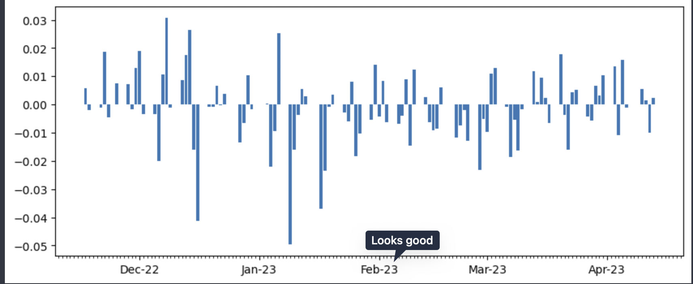

Looks good now.

## Cumulative returns

Cumulative returns shows the investment amount gained or lost over time. The formula is given by $$cumulative\_return = \frac{(current\_price - original\_price)}{(curent\_price)}$$

``` python
(pfe_df
 .Close
 .sub(pfe_df.Close[0])
 .div(pfe_df.Close[0])
 .plot()
)
```

    <AxesSubplot:xlabel='Date'>

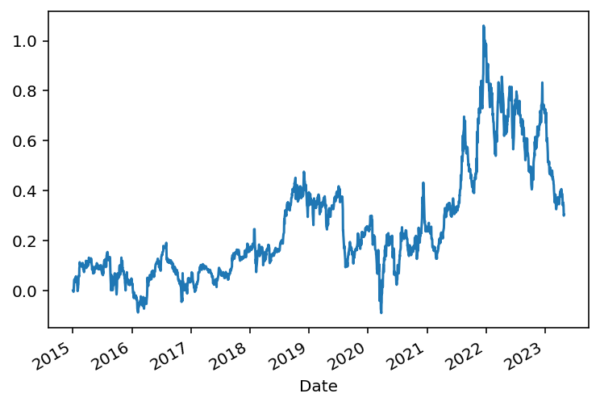

Another alternate way is to numpy’s `cumprod` function.

``` python
(pfe_df
 .Close
 .add(1)
 .cumprod()
 .sub(1)
 .plot()
)
```

    /Users/dross/miniforge3/envs/mlops/lib/python3.9/site-packages/numpy/core/fromnumeric.py:57: RuntimeWarning:

    overflow encountered in accumulate

    <AxesSubplot:xlabel='Date'>

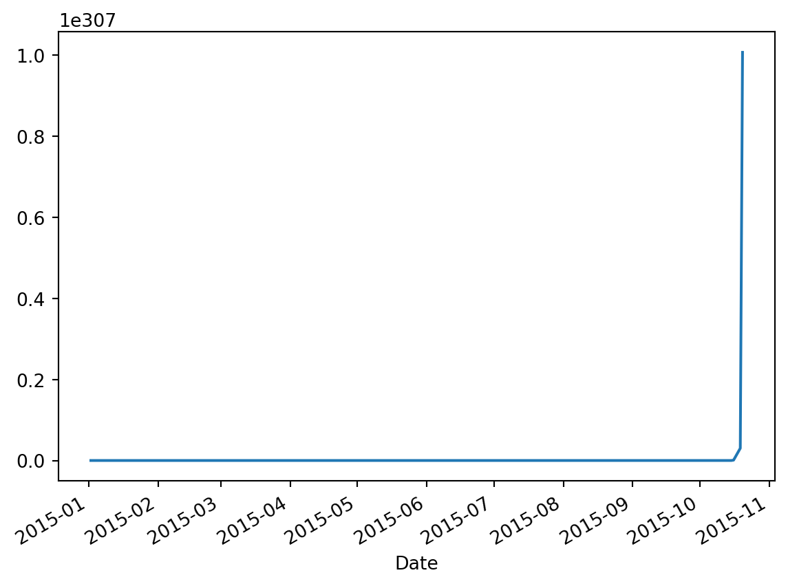

As you can see both plots give the same result.

If we’re to use `.pipe` here, we can do like so:

``` python
def calc_cumrets(df, col):
     ser = df[col]
     return (ser
             .sub(ser[0])
             .div(ser[0])
            )
(pfe_df
 .pipe(calc_cumrets,'Close')
 .plot()
)
```

    <AxesSubplot:xlabel='Date'>


### Lambda functions or anonymous functions

Using lambda functions we can make impropmtu functions and use it with our chaining.

We would traditionally call a function like so:

``` python
def get_returns(df):
    return calc_cumrets(df, 'Close')

get_returns(pfe_df)
```

    Date
    2015-01-02    0.000000
    2015-01-05   -0.005426
    2015-01-06    0.002873
    2015-01-07    0.016598
    2015-01-08    0.037344
                    ...   
    2023-04-21    0.352740
    2023-04-24    0.342647
    2023-04-25    0.323135
    2023-04-26    0.299586
    2023-04-27    0.303286
    Name: Close, Length: 2094, dtype: float64

However, if we are to use `lambda`, then the above code can be written as:

``` python
(lambda df: get_returns(df))(pfe_df)
```

    Date
    2015-01-02    0.000000
    2015-01-05   -0.005426
    2015-01-06    0.002873
    2015-01-07    0.016598
    2015-01-08    0.037344
                    ...   
    2023-04-21    0.352740
    2023-04-24    0.342647
    2023-04-25    0.323135
    2023-04-26    0.299586
    2023-04-27    0.303286
    Name: Close, Length: 2094, dtype: float64

Now, with cumulative returns calculation, it would be useful if those values can be assigned to a new column in the dataframe. It is here that a Pandas feature in `.assign` function is helpful. It helps create new columns. We can couple `.assign` and `lambda` together.

``` python
pfe_df = (pfe_df
 .assign(cum_rets=lambda df:calc_cumrets(df, 'Close'))
)
```

## Volatility

Volatility is a statistical measure of the dispertion of the returns for a given market index in this case stocks. In most cases, higher the volatility, the riskier the stock. It is often measured from either standard deviation or variance between returns from that stock. Remember `standard deviation` is the measure of deviation of the data relative to its mean.

Just like `mean()`, we can calculate `std()`.

``` python
(pfe_df
 .Close
 #.mean()
 .std()
)
```

    6.69077286484766

The `.assign()` allows consective chaining methods to use these newly created columns. In the below code block, we can use the `pct_change_close` created in the first line in to the second line. Then, we can calculate 30 day `rolling` volatility. Rolling is nothing but a time frame in which the volatility is calculated. We can see that for the first 15 days the volatility is `NaN`(not a number) and on the 30th day, there is an entry.

``` python
(pfe_df
 .assign(pct_change_close=pfe_df.Close.pct_change())
 .pct_change_close
 .rolling(30)
 .std()
)
```

    Date
    2015-01-02         NaN
    2015-01-05         NaN
    2015-01-06         NaN
    2015-01-07         NaN
    2015-01-08         NaN
                    ...   
    2023-04-21    0.008945
    2023-04-24    0.009058
    2023-04-25    0.009192
    2023-04-26    0.009718
    2023-04-27    0.009543
    Name: pct_change_close, Length: 2094, dtype: float64

``` python
#rolling volatility
(pfe_df
 .assign(close_volatility=pfe_df.rolling(30).Close.std(),
         percent_volatility=pfe_df.Close.pct_change().rolling(30).std())
 .iloc[:,-2:] # fetch only the last two columns
 .plot(subplots=True)

)
```

    array([<AxesSubplot:xlabel='Date'>, <AxesSubplot:xlabel='Date'>],
          dtype=object)

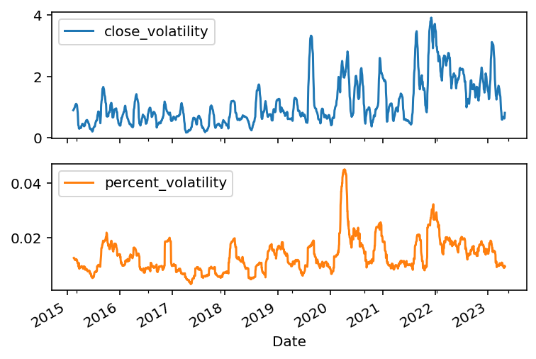

We can also use `.resample` to calculate 15 day volatility as we have `date` as index.

``` python
# 15 day volatility
(pfe_df
 .assign(pct_change_close=pfe_df.Close.pct_change())
 .resample('15D')
 .std()
)
```

|  | Adj Close | Close | High | Low | Open | Volume | cum_rets | pct_change_close |
|----|----|----|----|----|----|----|----|----|
| Date |  |  |  |  |  |  |  |  |
| 2015-01-02 | 0.423586 | 0.577756 | 0.554235 | 0.536322 | 0.565220 | 8.716662e+06 | 0.019437 | 0.009335 |
| 2015-01-17 | 0.408934 | 0.557768 | 0.552896 | 0.473576 | 0.428281 | 6.992238e+06 | 0.018764 | 0.011556 |
| 2015-02-01 | 0.864667 | 1.092056 | 1.124398 | 1.137237 | 1.027460 | 1.347935e+07 | 0.036739 | 0.013012 |
| 2015-02-16 | 0.103079 | 0.139368 | 0.153115 | 0.158683 | 0.142704 | 5.436585e+06 | 0.004689 | 0.006524 |
| 2015-03-03 | 0.232108 | 0.313819 | 0.310265 | 0.285296 | 0.329080 | 6.907642e+06 | 0.010557 | 0.008226 |
| ... | ... | ... | ... | ... | ... | ... | ... | ... |
| 2023-02-19 | 0.912909 | 0.922787 | 0.942723 | 1.064260 | 1.025597 | 4.710137e+06 | 0.031044 | 0.011505 |
| 2023-03-06 | 0.510382 | 0.515904 | 0.386680 | 0.472090 | 0.610293 | 1.148802e+07 | 0.017356 | 0.011168 |
| 2023-03-21 | 0.414519 | 0.419005 | 0.428108 | 0.305953 | 0.396622 | 3.416600e+06 | 0.014096 | 0.009084 |
| 2023-04-05 | 0.495242 | 0.500601 | 0.483455 | 0.430794 | 0.424291 | 4.807599e+06 | 0.016841 | 0.008860 |
| 2023-04-20 | 0.647205 | 0.654208 | 0.613951 | 0.713320 | 0.629458 | 2.507162e+06 | 0.022009 | 0.010312 |

203 rows × 8 columns

``` python
# 15 day rolling volatility
(pfe_df
 .assign(pct_change_close=pfe_df.Close.pct_change())
 .rolling(window=15, min_periods=15)
 .std()
)
```

|  | Adj Close | Close | High | Low | Open | Volume | cum_rets | pct_change_close |
|----|----|----|----|----|----|----|----|----|
| Date |  |  |  |  |  |  |  |  |
| 2015-01-02 | NaN | NaN | NaN | NaN | NaN | NaN | NaN | NaN |
| 2015-01-05 | NaN | NaN | NaN | NaN | NaN | NaN | NaN | NaN |
| 2015-01-06 | NaN | NaN | NaN | NaN | NaN | NaN | NaN | NaN |
| 2015-01-07 | NaN | NaN | NaN | NaN | NaN | NaN | NaN | NaN |
| 2015-01-08 | NaN | NaN | NaN | NaN | NaN | NaN | NaN | NaN |
| ... | ... | ... | ... | ... | ... | ... | ... | ... |
| 2023-04-21 | 0.591463 | 0.597864 | 0.638385 | 0.562327 | 0.596404 | 3.967966e+06 | 0.020113 | 0.009691 |
| 2023-04-24 | 0.657297 | 0.664410 | 0.695511 | 0.616351 | 0.626652 | 3.915626e+06 | 0.022352 | 0.009383 |
| 2023-04-25 | 0.771667 | 0.780017 | 0.784388 | 0.725364 | 0.709656 | 4.093416e+06 | 0.026241 | 0.008983 |
| 2023-04-26 | 0.957201 | 0.967559 | 0.939399 | 0.930587 | 0.843585 | 4.133347e+06 | 0.032551 | 0.009559 |
| 2023-04-27 | 1.047608 | 1.058944 | 1.047459 | 1.068349 | 1.011878 | 3.287318e+06 | 0.035625 | 0.008130 |

2094 rows × 8 columns

What happens if the assinged new column name is same as the pandas function name and we have to use further for our analysis? We can include that ‘assigned’ column within `[]`(square) braces and use it. In the below example, we can see how `pct_change` conflicts with pandas and is therefore must be put inside `[]` to access it.

``` python
# 15 day rolling volatility
(pfe_df
 .assign(pct_change=pfe_df.Close.pct_change())
 .rolling(window=15, min_periods=15)
 .std()
 #.pct_change
 ["pct_change"]
 .plot()
)
```

    <AxesSubplot:xlabel='Date'>

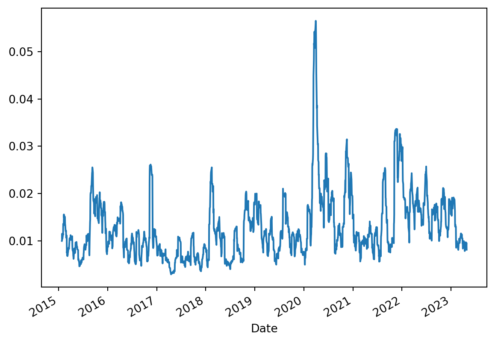

## Moving averages or rolling windows

Moving average(MA) of a stock is calculated to help smooth out the price data by creating a constantly updated average price. It helps to mitigate the impacts of random, short-term fluctuations on the prices of the stock over a time period. There are two types of moving averages - `simple` which is just the arithmetic mean of the given prices over a specified number of days and `exponential` which is the weighted average that gives significance to the recent prices than old ones, making it an indicator that is more responsive to new infotmation.

MA is used to identify the tread direction of a stock or to determine its support and resistance level as it depends on the past prices. The longer the period for the MA, the greater the lag. A 200-day MA has much greater lag than 20-day MA. The gold standard used by investers are 50-day and 200-day MAs.

Shorter MA for short-term investment and longer MA for long-term. A rising MA means upward trend and declining means downward trend.

### What is a Golden Cross?

A golden cross is a chart pattern in which a short-term moving average crosses above a long-term moving average. The golden cross is a bullish breakout pattern formed from a crossover involving a security’s short-term moving average such as the 15-day moving average, breaking above its long-term moving average, such as the 50-day moving average. As long-term indicators carry more weight, the golden cross indicates a bull market on the horizon and is reinforced by high trading volumes.

### Lag

These lags can be calculated in Pandas using `shift` function. `shift(1)` means shift index one place down. `shift(2)` means two places down. For example,

``` python
(pfe_df
 .assign(s1=pfe_df.Close.shift(1),
         s2=pfe_df.Close.shift(2))
 [["s1","s2"]]
)
```

|            | s1        | s2        |
|------------|-----------|-----------|
| Date       |           |           |
| 2015-01-02 | NaN       | NaN       |
| 2015-01-05 | 29.724857 | NaN       |
| 2015-01-06 | 29.563566 | 29.724857 |
| 2015-01-07 | 29.810247 | 29.563566 |
| 2015-01-08 | 30.218216 | 29.810247 |
| ...        | ...       | ...       |
| 2023-04-21 | 39.849998 | 40.240002 |
| 2023-04-24 | 40.209999 | 39.849998 |
| 2023-04-25 | 39.910000 | 40.209999 |
| 2023-04-26 | 39.330002 | 39.910000 |
| 2023-04-27 | 38.630001 | 39.330002 |

2094 rows × 2 columns

the `Close` value in the first row will be on the second row for `shift(1)` and two rows down for `shift(2)`.

Now for simple 3-day moving average, we need to average `Close`, `s1`, and `s2`. We can do it manually using a `lambda` and use the `rolling` pandas with `window=3` specified.

``` python
(pfe_df
 .assign(s1=pfe_df.Close.shift(1),
         s2=pfe_df.Close.shift(2),
         ma3=lambda df_:df_.loc[:,["Close", "s1", "s2"]].mean(axis='columns'),
         ma3_builtin=pfe_df.Close.rolling(3).mean()
        )
[["s1","s2","ma3","ma3_builtin"]]
)
```

|            | s1        | s2        | ma3       | ma3_builtin |
|------------|-----------|-----------|-----------|-------------|
| Date       |           |           |           |             |
| 2015-01-02 | NaN       | NaN       | 29.724857 | NaN         |
| 2015-01-05 | 29.724857 | NaN       | 29.644212 | NaN         |
| 2015-01-06 | 29.563566 | 29.724857 | 29.699557 | 29.699557   |
| 2015-01-07 | 29.810247 | 29.563566 | 29.864010 | 29.864010   |
| 2015-01-08 | 30.218216 | 29.810247 | 30.287793 | 30.287793   |
| ...        | ...       | ...       | ...       | ...         |
| 2023-04-21 | 39.849998 | 40.240002 | 40.100000 | 40.100000   |
| 2023-04-24 | 40.209999 | 39.849998 | 39.989999 | 39.989999   |
| 2023-04-25 | 39.910000 | 40.209999 | 39.816667 | 39.816667   |
| 2023-04-26 | 39.330002 | 39.910000 | 39.290001 | 39.290001   |
| 2023-04-27 | 38.630001 | 39.330002 | 38.900002 | 38.900002   |

2094 rows × 4 columns

## Plotting MAs

We are getting comfortable with plotting. We select the columns needed to plotted - \[‘Close’, ‘ma3_builtin’\] for last 200 rows.

``` python
(pfe_df
 .assign(s1=pfe_df.Close.shift(1),
         s2=pfe_df.Close.shift(2),
         ma3=lambda df_:df_.loc[:,["Close", "s1", "s2"]].mean(axis='columns'),
         ma3_builtin=pfe_df.Close.rolling(3).mean()
        )
 [['Close', 'ma3_builtin']]
 .iloc[-200:]
 .plot()
)
```

    <AxesSubplot:xlabel='Date'>

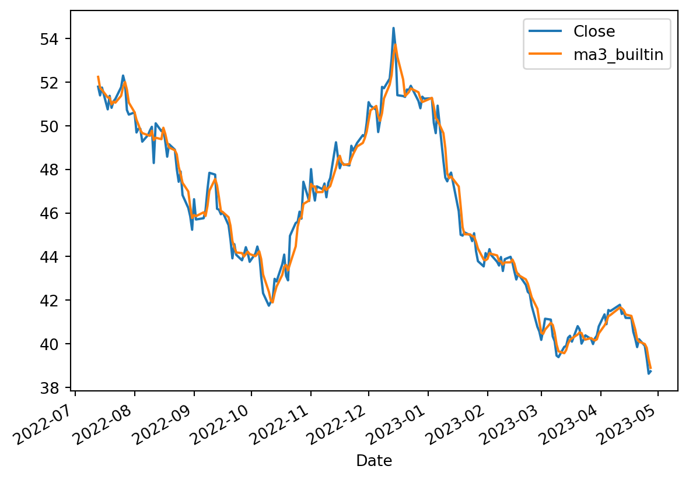

As we can see the MA smoothes out the little peaks and troughs.

### Golden Cross

Some experts say if there is a crossover between MA-50 and MA-200, it is an indicator to buy or sell.

``` python
(pfe_df
 .assign(ma50=pfe_df.Close.rolling(50).mean(),
         ma200=pfe_df.Close.rolling(200).mean()
        )
 [["Close","ma50","ma200"]]
 .iloc[-650:]
 .plot()
)
```

    <AxesSubplot:xlabel='Date'>

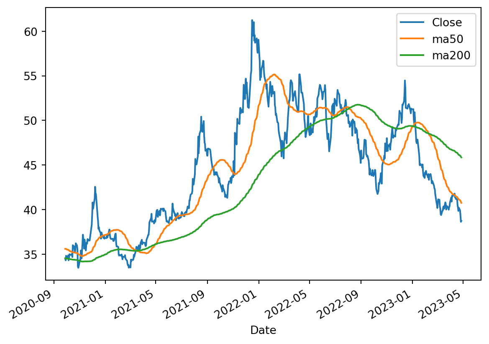

# Technical analysis

Technical analysis studies the price and volumes of the investments. Studying the trends on prices and volumes give analyst to evaluate and identify trading opportunities.

Technical analysis tools are used to scrutinize the ways supply and demand for a security will affect changes in price, volume, and implied volatility. Past prices are used to determine future prices.

## OBV- On-balance Volume

OBV is one such used for technical analysis. It is a momentum indicator that uses volume to predict changes in stock price.

### What Does On-Balance Volume Tell You?

The actual value of the OBV is unimportant; concentrate on its direction. (source: [fidelity](https://www.fidelity.com/learning-center/trading-investing/technical-analysis/technical-indicator-guide/obv))

- When both price and OBV are making higher peaks and higher troughs, the upward trend is likely to continue.

- When both price and OBV are making lower peaks and lower troughs, the downward trend is likely to continue.

- During a trading range, if the OBV is rising, accumulation may be taking place—a warning of an upward breakout.

- During a trading range, if the OBV is falling, distribution may be taking place—a warning of a downward breakout.

- When price continues to make higher peaks and OBV fails to make higher peaks, the upward trend is likely to stall or fail. This is called a negative divergence.

- When price continues to make lower troughs and OBV fails to make lower troughs, the downward trend is likely to stall or fail. This is called a positive divergence.

### OBV calculation

If today’s close is greater than yesterday’s close then: OBV = Yesterday’s OBV + Today’s Volume

If today’s close is less than yesterday’s close then: OBV = Yesterday’s OBV – Today’s Volume

If today’s close is equal to yesterday’s close then: OBV = Yesterday’s OBV

$$OBV = OBV_{prev} + \begin{cases}
volume, \text{ if close > close}_{prev} \\
0, \text{ if close = close}_{prev}\\
-volume, \text{ if close < close}_{prev}
\end{cases}$$

where

OBV = current on-balance volume level

OBV_(prev) = previous on-balance volume level

volume = Latest trading volume amount

### Python - Naive approach

``` python
def calc_obv(df): 
    df = df.copy() 
    df["OBV"] = 0.0 
    for i in range(1, len(df)): 
        if df["Close"][i] > df["Close"][i - 1]: 
            df["OBV"][i] = df["OBV"][i-1] + df["Volume"][i] 
        elif df["Close"][i] < df["Close"][i - 1]: 
            df["OBV"][i] = df["OBV"][i-1] - df["Volume"][i] 
        else: 
            df["OBV"][i] = df["OBV"][i-1] 
    return df

calc_obv(pfe_df)
```

It takes a while to complete. That is too long. Another approach would be to use numpy’s `where` condition. Inserting the conditions needs some thinking and isn’t obvious as seeing the mathematical formula. So we avoid `np.where` even though it is faster than naive python approach.

### Preferred choice to calculate OBV - np.select

The syntax of `np.select` is easy to understand - we specify the conditions list, their choices and a default value if the conditions aren’t satisfied.

``` python
np.select(condlist=[pfe_df.Close < 7.5, pfe_df.Close > 70],
          choicelist=[7.55, 72], default= 34)
```

    array([34., 34., 34., ..., 34., 34., 34.])

So our code will be like so -

``` python
(pfe_df
 .assign(vol=np.select(condlist=[pfe_df.Close > pfe_df.Close.shift(1),
                                 pfe_df.Close == pfe_df.Close.shift(1),
                                 pfe_df.Close < pfe_df.Close.shift(1)],
                       choicelist=[pfe_df.Volume, 0, -pfe_df.Volume]),
        obv=lambda df_:df_.vol.cumsum()
        )
)
```

|  | Adj Close | Close | High | Low | Open | Volume | cum_rets | vol | obv |
|----|----|----|----|----|----|----|----|----|----|
| Date |  |  |  |  |  |  |  |  |  |
| 2015-01-02 | 21.793076 | 29.724857 | 30.151802 | 29.620493 | 29.667933 | 16371571 | 0.000000 | 0 | 0 |
| 2015-01-05 | 21.674822 | 29.563566 | 29.800758 | 29.421251 | 29.743834 | 24786391 | -0.005426 | -24786391 | -24786391 |
| 2015-01-06 | 21.855684 | 29.810247 | 30.227703 | 29.525618 | 29.667933 | 29468681 | 0.002873 | 29468681 | 4682290 |
| 2015-01-07 | 22.154783 | 30.218216 | 30.237192 | 29.962049 | 30.094877 | 20248816 | 0.016598 | 20248816 | 24931106 |
| 2015-01-08 | 22.606922 | 30.834915 | 30.967743 | 30.569260 | 30.683111 | 49169522 | 0.037344 | 49169522 | 74100628 |
| ... | ... | ... | ... | ... | ... | ... | ... | ... | ... |
| 2023-04-21 | 39.779552 | 40.209999 | 40.299999 | 39.910000 | 40.090000 | 19227100 | 0.352740 | 19227100 | -538012626 |
| 2023-04-24 | 39.482765 | 39.910000 | 40.200001 | 39.709999 | 40.189999 | 17633700 | 0.342647 | -17633700 | -555646326 |
| 2023-04-25 | 38.908978 | 39.330002 | 39.919998 | 39.279999 | 39.750000 | 24492400 | 0.323135 | -24492400 | -580138726 |
| 2023-04-26 | 38.216469 | 38.630001 | 39.189999 | 38.400002 | 39.160000 | 22401400 | 0.299586 | -22401400 | -602540126 |
| 2023-04-27 | 38.325291 | 38.740002 | 38.830002 | 38.310001 | 38.619999 | 22434000 | 0.303286 | 22434000 | -580106126 |

2094 rows × 9 columns

Putting this as function,

``` python
def calc_obv(df, close_col="Close", vol_col="Volume"):
    close = df[close_col]
    vol = df[vol_col]
    close_shift = close.shift(1)
    return (df
             .assign(vol=np.select(condlist=[close > close.shift(1),
                                   close == close.shift(1),
                                   close < close.shift(1)],
                                  choicelist=[vol, 0, -vol]),
                     obv=lambda df_:df_.vol.fillna(0).cumsum()
                    )
             ["obv"]
    )

(pfe_df
    .assign(obv=calc_obv)
    .obv
    .plot()
)
```

    <AxesSubplot:xlabel='Date'>

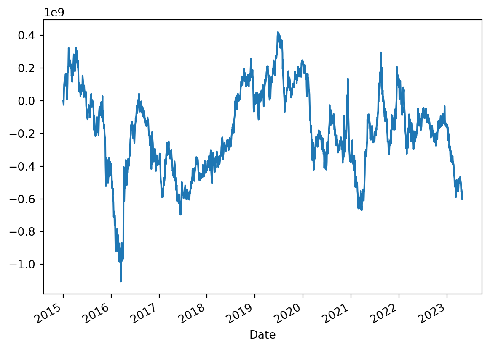

## Accumulation distribution indicator

### What is A/D and why is it needed?

A/D is an evolution of OBV to find the relationship between the price and volume flow of the stock. OBV, from its formula totally relies on the closing value and the volume is either added or substracted giving total bias either to the buyers or sellers. This is not realistic. So A/D brings proporation to the context. In other words it brings a multipler that ranges from `-1 to +1`. Realistically the value is between this range and therefore providing realistic volume flow.

Formula for A/D is given by $$A\\/D = A\\/D_{prev} + (\text{money flow  multiplier} * \text{current volume})$$ where Money flow multiplier and Current Volume is given by

$MFM = \frac{(Close - Low) - (High - Close)}{(High - Low)}$ $CV = \text{MFM} * \text{period volume}$

### What does A/D indicate?

It is a cumulative indicator that uses volume and price to assess whether a stock is accumulating or distributing.

### Calculation

``` python
(pfe_df
 .assign(mfm=((pfe_df.Close-pfe_df.Low) - (pfe_df.High-pfe_df.Close)) / (pfe_df.High-pfe_df.Low),
         mfv=lambda df_:df_.mfm * df_.Volume,
         cmfv = lambda df_:df_.mfv.cumsum()
        )
)
```

|  | Adj Close | Close | High | Low | Open | Volume | cum_rets | mfm | mfv | cmfv |
|----|----|----|----|----|----|----|----|----|----|----|
| Date |  |  |  |  |  |  |  |  |  |  |
| 2015-01-02 | 21.793076 | 29.724857 | 30.151802 | 29.620493 | 29.667933 | 16371571 | 0.000000 | -0.607142 | -9.939876e+06 | -9.939876e+06 |
| 2015-01-05 | 21.674822 | 29.563566 | 29.800758 | 29.421251 | 29.743834 | 24786391 | -0.005426 | -0.250001 | -6.196629e+06 | -1.613650e+07 |
| 2015-01-06 | 21.855684 | 29.810247 | 30.227703 | 29.525618 | 29.667933 | 29468681 | 0.002873 | -0.189188 | -5.575108e+06 | -2.171161e+07 |
| 2015-01-07 | 22.154783 | 30.218216 | 30.237192 | 29.962049 | 30.094877 | 20248816 | 0.016598 | 0.862063 | 1.745575e+07 | -4.255863e+06 |
| 2015-01-08 | 22.606922 | 30.834915 | 30.967743 | 30.569260 | 30.683111 | 49169522 | 0.037344 | 0.333333 | 1.638984e+07 | 1.213398e+07 |
| ... | ... | ... | ... | ... | ... | ... | ... | ... | ... | ... |
| 2023-04-21 | 39.779552 | 40.209999 | 40.299999 | 39.910000 | 40.090000 | 19227100 | 0.352740 | 0.538460 | 1.035302e+07 | 6.969870e+08 |
| 2023-04-24 | 39.482765 | 39.910000 | 40.200001 | 39.709999 | 40.189999 | 17633700 | 0.342647 | -0.183673 | -3.238837e+06 | 6.937482e+08 |
| 2023-04-25 | 38.908978 | 39.330002 | 39.919998 | 39.279999 | 39.750000 | 24492400 | 0.323135 | -0.843740 | -2.066523e+07 | 6.730830e+08 |
| 2023-04-26 | 38.216469 | 38.630001 | 39.189999 | 38.400002 | 39.160000 | 22401400 | 0.299586 | -0.417721 | -9.357525e+06 | 6.637254e+08 |
| 2023-04-27 | 38.325291 | 38.740002 | 38.830002 | 38.310001 | 38.619999 | 22434000 | 0.303286 | 0.653846 | 1.466838e+07 | 6.783938e+08 |

2094 rows × 10 columns

Making it as a function,

``` python
def calc_ad(df, close_col="Close",low_col="Low",high_col="High",vol_col="Volume"):
    close = df[close_col]
    low = df[low_col]
    high = df[high_col]
    vol = df[vol_col]
    return (df
             .assign(mfm=((close-low) - (high-close))/ (high-low),
                     mfv=lambda df_:df_.mfm * vol,
                     cmfv=lambda df_:df_.mfv.cumsum()       
                    )  
             .cmfv
           )
(pfe_df
    .assign(ad=calc_ad)
    .ad
    .plot()
)
```

    <AxesSubplot:xlabel='Date'>

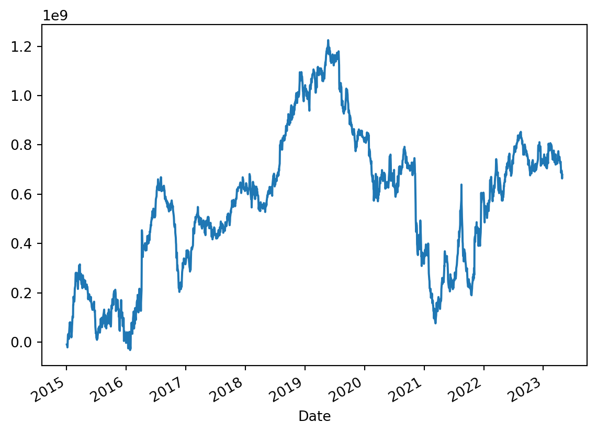

### Comparing OBV and AD

``` python
(pfe_df
    .assign(obv=calc_obv,
            ad=calc_ad
           )
    [["obv","ad"]]
    .iloc[-650:]
    .plot()

)
```

    <AxesSubplot:xlabel='Date'>

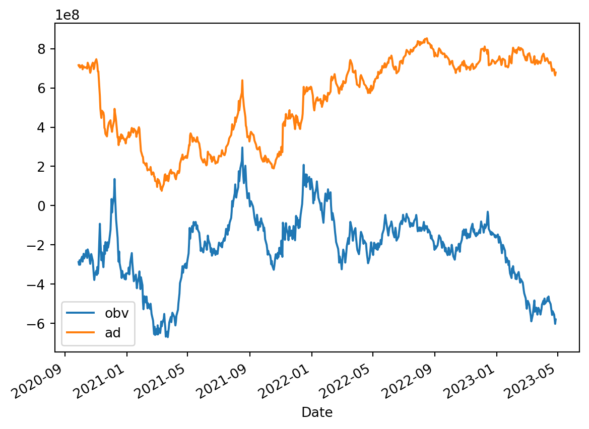

## RSI - Relative strength index

Back to top
